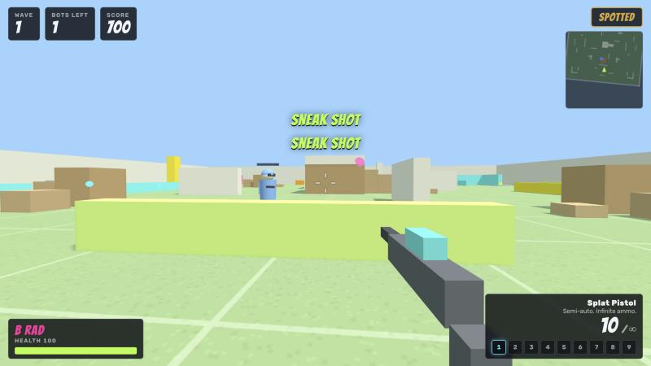

# Scott Davis

I build workflows that let AI coding agents do real work safely. I also build tools for my own household, and now and then a browser game.

## Play something

**[Ironport](https://github.com/blklite/ironport)**: an open-city crime game in one HTML file. Steal cars, take jobs, rob shops, and lose the police with squirty cream. It is built with three.js, with no build step.
**[Play it in your browser →](https://blklite.github.io/ironport/)** (a keyboard is required)

**[B Rad Paint War](https://github.com/blklite/b-rad-paint-war)**: a first-person paintball shooter in one HTML file. Play as B Rad against waves of bots, with 9 weapons. Stay out of their sight, crouch behind cover, and splat them from behind. It is built with three.js, with no build step.
**[Play it in your browser →](https://blklite.github.io/b-rad-paint-war/)** (a keyboard and a mouse are required)

## Projects

**[spec-to-ship-workbench](https://github.com/blklite/spec-to-ship-workbench)**
A spec goes in, checked work comes out. This is a 6-stage process for coding agents: intake, spec check, build, checks by risk tier, fix loop, and delivery. It comes with decision rights, cost rules, prompts, and a secret scan, and it does not depend on one model vendor. *Python*

**[household-coordination-board](https://github.com/blklite/household-coordination-board)**
A weekly whiteboard, dinner plan, and grocery list for a busy blended household, built from the family calendars. Code decides every event, time, and kid location. Claude writes only the notes, and code checks each reply against a schema. *Python*

## What I work with

Python · JavaScript and three.js · Claude Code and AI agent workflows · Azure DevOps · Raspberry Pi home lab

## Right now

- Building Ironport and B Rad Paint War with a friend, through pull requests.
- Taking the workbench to v0.1b: a plugin, slash commands, and runner adapters.
